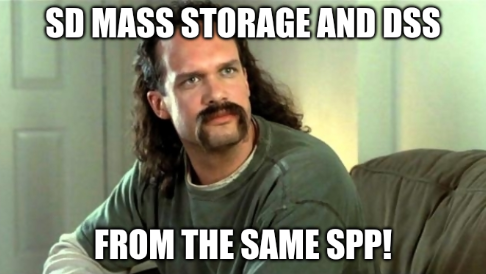
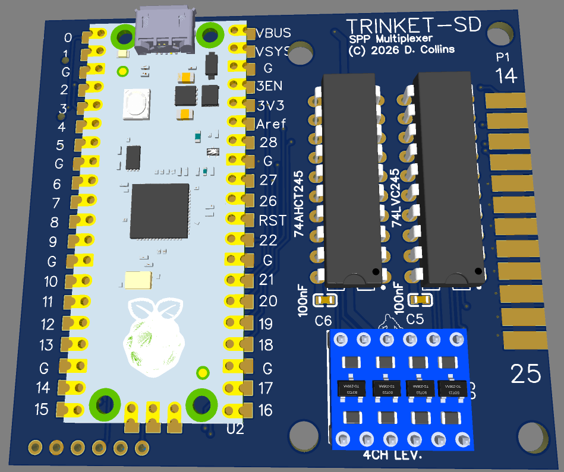
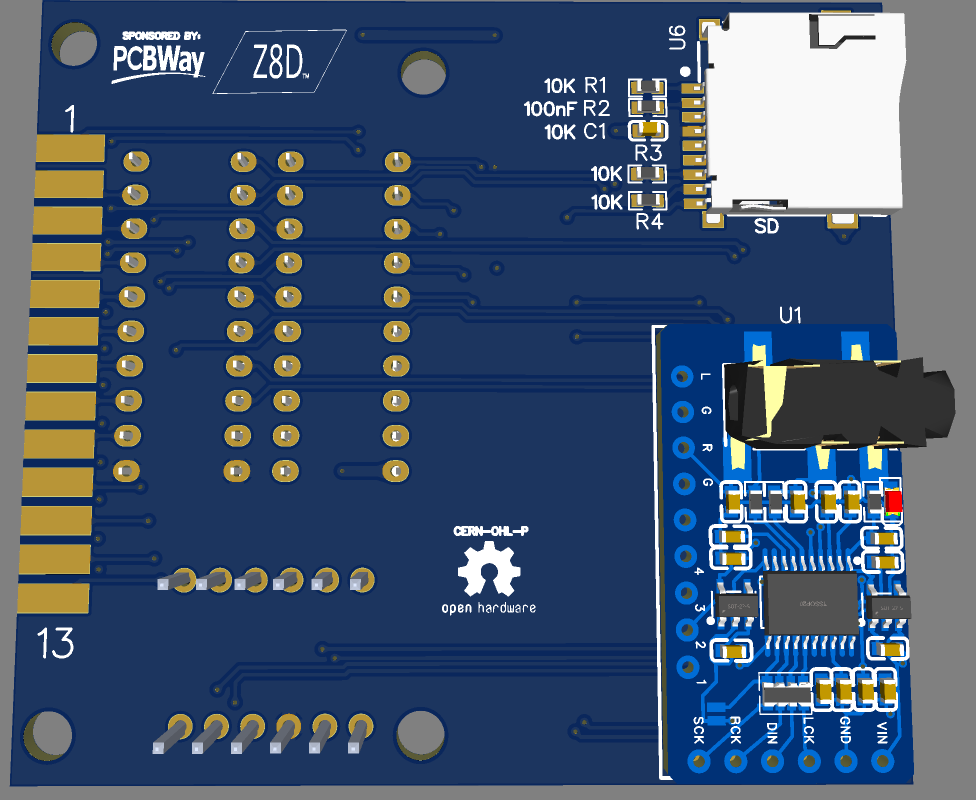

# Trinket SD

<p align="center">
  
</p>

SD-card storage and sound for DOS-era PCs, through an ordinary parallel port.

The trinket is a small board built around a Raspberry Pi Pico (RP2040). It
plugs into a PC's printer port (SPP mode, no ECP/EPP needed) and gives a DOS
machine two things at once:

- **An SD card as a normal DOS drive.** `TRINKET.SYS` is a `CONFIG.SYS`
  block-device driver. DOS sees a drive with a BPB, like a floppy or a hard
  disk, and handles `DIR`, `COPY`, running programs, and so on by itself.
  No TSR, no redirector.
- **Sound.** The trinket plays **Disney Sound Source** audio for games that
  already know how to drive one (the game writes the printer port directly,
  nothing is installed on the PC for this), and it has a **PCM5102 I2S DAC**
  path for raw PCM playback.

Why bother? Projects like `sdpp` bit-bang an SD card directly from the
parallel-port pins, relying on the card, the module's level shifter, and the
port wiring to cooperate. Here, the port talks only to a fixed, level-shifted
interface, while the RP2040 handles the SD card. This approach is predictable,
faster than bit-banging the card, and compatible with more cards. It also
reduces the risk of damaging a card due to non-standard current levels on the
parallel port.

You can also add features to the Trinket, such as support for different sound
hardware. Last but not least, you can have sound, at the same time! 
That's likely the best part. Beyond that, what more could you ask for?


## Photos

| Trinket SD enclosure and internal module | Close-up of the top assembly |
|---|---|
|  |  |

| PCB render with Raspberry Pi Pico | PCB render with SD module and DAC |
|---|---|
|  |  |

| Bottom plate | Top plate |
|---|---|
|  |  |

## Read this first

> **The SD card is fixed media. Never insert, remove or swap the card while
> the trinket is powered.**
> The SD socket is wired straight to an always-on 3.3 V rail; there is no
> card-detect wiring, and the firmware has no graceful-unmount path. The
> card's data can be corrupted if it is pulled out (or pushed in)
> mid-operation, most likely by interrupting a write at the card's most
> vulnerable moment. Power down, change the card, then power up.

## Status

Most testing was done on one bench rig: a VIA Eden thin client with a real
parallel port, running FreeDOS. A real 4.77 MHz XT-class machine has also
been tested.

| Area | State |
|---|---|
| SD init, sector read/write, media check | Confirmed on hardware |
| DOS running software from the card (Wolfenstein 3D) | Confirmed on hardware |
| Disney Sound Source emulation (`DSSTEST`, Wolf3D digitized sound) | Confirmed on hardware; mild dropouts during disk loads (see [Known limitations](#known-limitations)) |
| Interrupt guard, `/l=` (`DSSSTRES` clean with the guard on, fails with `/l=0` as designed) | Confirmed on hardware |
| PCM playback through the DAC (`DACTEST play`) | Confirmed at 8 kHz mono 8-bit. 44.1 kHz 16-bit stereo underruns (too much data for the port) |
| Deeper Sound Source FIFO (`/f=`, `/w=`, `DSSCFG`) | Implemented and unit-tested on a host. |
| Real 4.77 MHz XT-class machine | **Tested** |
| Tandy-style Sound Source (strobe value `0Eh`) | Not supported |
| FAT32 cards | Not supported. Use FAT16 |

## What you need

- **A trinket board** with firmware flashed (step 2 below), a DB-25 parallel
  cable to the PC, and a way to power the Pico. Typically, power is supplied
  through the board's USB connector (Micro-USB on the Raspberry Pi Pico; USB-C
  on some clones).

- **A microSD/SD card, 2 GB or smaller recommended, formatted FAT16** with
  512-byte sectors and an MBR partition table. The driver handles SDv1/MMC
  and SDv2/SDHC cards; testing was done with a 2 GB FAT16 card.
- **A DOS PC with a standard (SPP) parallel port** at a known address. LPT1
  at 378h is the default. The bench rig used FreeDOS. The driver and tools
  are compiled for the plain 8086 (no 186/286 compiler switches).
- **To build from source instead of using the prebuilt files:** see
  [Building from source](#building-from-source).

## Quick start

1. **Get the files.** Either download a release or build (`./build.sh`) and use
   what lands in `dist/`:

   | File | Goes to |
   |---|---|
   | `trinket_sd.uf2` | The trinket (firmware) |
   | `TRINKET.SYS` | The DOS machine, loaded from `CONFIG.SYS` |
   | `SDTEST.EXE`, `IFTEST.EXE`, `DACTEST.EXE`, `DSSTEST.EXE`, `DSSSTRES.EXE`, `DSSCFG.EXE` | The DOS machine, optional tools (see [Tools](#tools)) |

2. **Flash the firmware.** Hold the Pico's BOOTSEL button while connecting its
   USB port to a modern computer. It shows up as a drive named `RPI-RP2`.
   Copy `trinket_sd.uf2` onto it. The Pico reboots by itself. **Note:** If the
   front and back plates are installed, you can press the button through the
   decorative vent holes with closed, right-angle tweezers or another blunt
   tool while plugging in the USB cable.

3. **Prepare the card.** On a modern machine, format it FAT16 with an MBR
   (a single primary partition is the simple case). Copy over whatever you
   want on it. Safely eject, then insert the card into the trinket **while
   the trinket is unpowered**.

4. **Cable it up.** Connect the trinket to the parallel port with the PC
   powered down, then power the trinket.

5. **Install the driver.** Copy `TRINKET.SYS` to the DOS machine and add to
   `CONFIG.SYS`:

   ```
   DEVICE=C:\TRINKET\TRINKET.SYS
   ```

   For a port other than LPT1 at 378h, or other options, see
   [CONFIG.SYS options](#configsys-options).

6. **Reboot and check the boot messages.** A good start looks like:

   ```
   TRINKET.SYS - SD card via trinket parallel port bridge
   TRINKET: card ready (SDv2, block-addressed)
   SD initialized on DOS drive D
   ```

   The drive letter is whatever DOS assigns next. `DIR D:` should list your
   card. If you instead see `SD: adapter or card not found`, go to
   [Troubleshooting](#troubleshooting).

## Staging media from the SD card directly

You can copy TRINKET.SYS to a floppy directly if you prepare a DOS disk
that contains a BASIC interpreter. Please refer to `./alternate_bootstrap`
for details. A short, 100-line BASIC program that you enter by hand lets you
copy the driver using the disk's BASIC interpreter, then boot from the mounted
SD card.

## Using it

### Storage

The card is a normal DOS drive. Anything DOS can do to a FAT16 volume works:
`DIR`, `COPY`, `DEL`, running programs, and so on. A few practical notes:

- Keep the card fixed (see [Read this first](#read-this-first)).
- The driver checks the volume ID of the card on media-change queries and
  caches the answer for about two seconds, so a swap would be caught if it
  happened, but do not rely on that. Swapping is unsupported.
- Large requests are split into chunks (`/l=`, default one sector) so that
  other programs' interrupt handlers get a turn. See below.

#### Performance

On the bench rig, a 512-byte sector takes about 17 ms over the port, or
roughly 30 KB/s sustained. A slower PC will be slower. In informal testing,
Wolfenstein 3D ran from the card no slower than it did from a parallel-port
Zip drive. The limit is the port's byte-at-a-time handshake, not the SD card.
Reading a byte takes about twice as many handshakes as writing one.

### Sound: Disney Sound Source

For any program that supports the Disney Sound Source:

1. Install the driver as above (the sound side does not need it, but it keeps
   disk and sound from stepping on each other, see below).
2. In the program's sound setup, choose **Disney Sound Source** on the
   printer port the trinket is plugged into (LPT1 / 378h for most setups).
3. Play.

The trinket recognises a game driving a Sound Source by its control-register
writes (`04h` / `0Ch`), emulates the unit's 16-byte FIFO and its fixed 7 kHz
drain rate, answers the game's "FIFO full" poll, and plays the samples
through the DAC. Nothing resident is needed on the PC for this.

Confirmed with stock Wolfenstein 3D.

### Sound: PCM through the DAC

`DACTEST` streams raw PCM to the DAC directly. It is a diagnostic and
bring-up tool, not a player for general use.

```
DACTEST beep                    1 kHz test tone, internal DAC clock
DACTEST beep_ext                1 kHz test tone, external clock on GPIO26
DACTEST tone 440 2000           440 Hz for 2000 ms
DACTEST play SOUND.PCM 8000 1 int 8      file, rate, channels, clock, bits
DACTEST status                  DAC state, queue, underruns
DACTEST stop
```

`play` does **no resampling**. If the file is not really encoded the way you
tell it, it plays at the wrong speed and pitch. Make files to match, for
example with SoX:

```
sox in.wav -r 8000 -c 1 -b 8 -e unsigned-integer SOUND.PCM
```

How much audio fits: the port moves roughly 137 KB/s when reading from the
SD card and writing to the DAC at once (derived from observed underruns).
8 kHz mono 8-bit (8 KB/s) played 80 seconds cleanly on hardware. 44.1 kHz
16-bit stereo (176 KB/s) is beyond what the port can carry and underruns
badly. Rates in between are untested, though 22.05 kHz 16-bit stereo
(88 KB/s) has about 36 % headroom on paper.

### Sound and storage together

Both share one parallel port. A game's sound feeder (a timer interrupt)
and a disk transaction can collide, so `TRINKET.SYS` runs every sector
transfer with interrupts off, in windows of `/l=` sectors. With the default
`/l=1` a game gets a turn between every sector. In practice sound plays
through disk access with at most a brief dropout, for example in Wolfenstein
3D's demo, which loads data while playing samples. During sustained disk
reads most of a game's timer interrupts are held off while the driver owns
the port, which can slow a game's own clock.

## CONFIG.SYS options

```
DEVICE=TRINKET.SYS [/d] [/p=n] [/b=n] [/l=n] [/f=n] [/w=ms] [/k]
```

| Option | Meaning | Default |
|---|---|---|
| `/p=n` | Partition number (1-4) in the MBR to use | First available |
| `/b=n` | Port base: 1 = 3BCh, 2 = 378h, 3 = 278h, 4 = 3E8h, 5 = 2E8h | 2 (378h) |
| `/l=n` | Sectors per interrupts-off window, 0-64. Smaller = shorter sound gaps; `0` = never disable interrupts, use full 64-sector transfers (only safe if nothing else ever writes the port, i.e. no Sound Source software) | 1 |
| `/f=n` | Sound Source FIFO depth to present, 16-512 bytes. 0 or omitted = leave the trinket at the real unit's 16. **Experimental, unconfirmed on hardware** | off |
| `/w=ms` | Warm-up (0-2000 ms) during which a freshly powered-up program sees the real 16-byte FIFO so its detection test passes. Only used with `/f` | 250 |
| `/d` | Verbose driver messages | off |
| `/k` | Accepted and ignored (card detect is not wired) | |

Bad options print `SD: bad options in CONFIG.SYS` or a specific
`SD: Invalid ...` message. `DSSCFG.EXE` can show or change the FIFO depth at
run time (`DSSCFG`, `DSSCFG 256`, `DSSCFG default`). The setting lives in the
trinket's RAM and does not survive a trinket power cycle. `/f` and `/w` are
what make it permanent, since the driver re-sends them every time it
initialises the card. Details in [DSS.md](./DSS.md).

## Tools

All are plain DOS `.EXE` programs. They talk to the port directly, so run
them from the DOS prompt, not while a game is using the sound path. Each
takes `/P=378` to pick a different port.

| Tool | What it is for |
|---|---|
| `IFTEST` | Lowest-level wire check: resets the trinket, sends a byte, reads it back. Run this first if nothing works. `IFTEST [byte_hex] [port_hex]` |
| `SDTEST` | SD and FAT16 diagnostics that bypass `TRINKET.SYS`: `init`, `dir`, `cat NAME`, `readsector LBA`, `writesector LBA -y`, `bench`, plus the `fast*` commands that use the firmware's SD offload (`fastinit`, `fastcheck`, `fastread`, `fastwrite`, `fastbench`) |
| `DACTEST` | DAC beeps, tones, PCM streaming, status/underruns, and a storage+audio coexistence test (`coex`) |
| `DSSTEST` | Behaves like a game driving a Sound Source: `detect`, `rate`, `tone`, `play` |
| `DSSSTRES` | Stress test for interrupt collisions between a game-style sound feeder and disk I/O. `read` is safe, `write` creates and deletes a scratch file on the card |
| `DSSCFG` | Show or change the Sound Source FIFO depth |

## Checking an installation

Work up from the bottom. Stop at the first step that fails.

1. `IFTEST` reports `MATCH`. The wire, the cable and the firmware are alive.
2. `SDTEST init` finds and parses the card's FAT16 volume. The SD side works
   without the driver.
3. The boot messages show `card ready` and `SD initialized on DOS drive X`,
   and `DIR` on that drive works.
4. `DACTEST beep` makes a tone. The DAC works.
5. `DSSTEST detect` exits with code 0. The Sound Source emulation works.
   `DSSTEST tone 440 3` should play a steady 440 Hz.

## Troubleshooting

| Symptom | Likely cause |
|---|---|
| `SD: adapter or card not found` / `try another port` | Wrong port (`/b=`), cable not connected, firmware not flashed, or no card. Run `IFTEST` to separate "wire dead" from "card problem" |
| `TRINKET: SD_OP_INIT failed` | The trinket answered but the card did not initialise. Power down, reseat the card, try another card, run `SDTEST init` |
| Drive appears but `DIR` errors | Card is not FAT16 with 512-byte sectors, or `/p=` names the wrong partition |
| Abort/Retry/Ignore errors during sound | A sound feeder collided with a disk transfer. Make sure `/l=` is not `0` |
| Sound plays at the wrong pitch | The file's real rate is not what it was declared as (DACTEST), or it is not 7 kHz unsigned 8-bit mono (DSSTEST) |
| Pops or underruns in `DACTEST status` | The data rate is higher than the port carries. Lower the rate or bit depth |
| A game's clock runs slow during long disk reads | Timer interrupts are held off while the driver owns the port. This is expected. `DSSSTRES` shows how many ticks are lost and resyncs the DOS clock from the RTC |

Firmware diagnostics: the Pico exposes a USB serial console. Open it in any
terminal program. Pressing **ESC** prints a diagnostic report covering the
hardware, SD card, DAC, and Sound Source; toggles verbose logging on or off;
resets every subsystem to idle; and plays a short test beep. Do not press it
during a test run. The console is serviced only between commands: after a
game's Sound Source session, it responds when the card is next accessed.
The Pico's on-board LED shows dispatch activity.

## Known limitations

- **FAT16 only**, 512-byte sectors, one drive.
- **SD card is fixed media** (see the warning at the top).
- **Speed is bounded by the port.** Multi-block SD commands (`CMD18`/`CMD25`)
  and a burst-transfer redesign of the wire protocol are not implemented.
  Either would raise that ceiling; neither has been started.
- **Brief dropouts** can happen in a Sound Source game while it loads from
  the card. Mild dropouts were heard during Wolfenstein 3D's demo on
  hardware. The deeper FIFO (`/f=`) is intended to help, but is unconfirmed.
- **Sound Source detection** by games that probe at an arbitrary moment (not
  at power-up) may fail at a deep FIFO depth. Set `DSSCFG default` if so.
- The Sound Source path is designed to work on an 8088 (no port trapping), but
  its timing on an XT has not yet been measured.

## Hardware

The prototype is a Raspberry Pi Pico plus three level-translation parts and
an SD socket module:

| Part | Role |
|---|---|
| Pico (RP2040) | Everything: wire protocol, SD driving, audio |
| 4-channel bidirectional MOSFET level shifter | Control lines LPT pins 1, 14, 16, 17 (5 V PC side to 3.3 V) |
| 74LVC245 | Data lines D0-D7, LPT pins 2-9, PC to Pico |
| 74AHCT245 | Status lines LPT pins 10, 11, 12, 13, 15, Pico to PC |
| SD module (3.3 V regulator + 74LVC125 level shifter) | SPI-mode card socket |
| PCM5102 I2S DAC | Audio |

The complete GPIO map, header assignments and the register-inversion table
are in [firmware/README.md](./firmware/README.md). The PCM5102 connects as
GPIO16 = BCK, GPIO17 = LRCK, GPIO27 = DIN, GPIO26 = SCLK (the module's solder
bridges all left open on the prototype), 3.3 V and GND.

## Building from source

Three build targets, from three scripts (or `make`, which wraps them):

```
./check-toolchain.sh   # what is installed and what is missing
./build.sh             # firmware + DOS driver + DOS tools -> dist/
./clean-all.sh
```

| Target | Script | Needs |
|---|---|---|
| RP2040 firmware (`trinket_sd.uf2`) | `build-firmware.sh` | `arm-none-eabi-gcc`, `cmake`, `git`. The Pico SDK 2.3.0 is cloned on first run |
| DOS driver (`TRINKET.SYS`) | `build-driver.sh` | `dosbox` + **Borland C++ 3.1** in `legacy/bc31/` |
| DOS tools (`*.EXE`) | `build-client.sh` | same as the driver |

**You must supply Borland C++ 3.1 yourself.** It is proprietary, so
`legacy/bc31/` is gitignored and a clone will not contain it. The DOS build
scripts stop with a message saying so if it is missing. Full details,
including the compiler pitfalls that matter when changing the driver, are in
[TOOLCHAIN.md](./TOOLCHAIN.md).

`make package` builds release archives (`.tar.gz`, `.7z`, `.zip`) from
everything in `dist/` and a source archive (`trinket_sd-source.tar.gz`).
All archives are placed in `packages/`, which is separate from build output
and is preserved by `make clean`. Packaging needs `7z` and `zip`.

## Repository layout

| Path | Contents |
|---|---|
| `src/` | `TRINKET.SYS` driver (Borland C++ 3.1 / TASM) |
| `firmware/src/` | RP2040 firmware (C, Pico SDK) |
| `firmware/client/` | DOS test and configuration tools |
| `firmware/tests/` | Host-side unit tests for the Sound Source model (`run_tests.sh`) |
| `DSS.md` | Disney Sound Source emulation reference |
| `TOOLCHAIN.md` | Build environment reference and compiler hazards |
| `docs/history/` | Development notes, superseded plans and test logs. Kept for the record, **not** a current reference. Start with its README |

## Sponsor

PCBWay sponsored the fabrication of the Trinket SD PCBs. Thanks to PCBWay for
supporting this project. [Visit PCBWay](https://www.pcbway.com/) for your PCB
fabrication needs.

[](https://www.pcbway.com/)

## Credits and license

The driver core derives from [sdpp](https://github.com/nilseuropa/sdpp)
(R. Armstrong, D. Marks, ChaN, nilseuropa). `src/HEADER.ASM`, `CPRINT.*`,
`STANDARD.H` and `INTEGER.H` are unchanged from it, `DRIVER.C` and `SD.C`
are modified, and `TRINKET.C` replaces its bit-banged SPI layer with
this project's wire protocol. Licensed under the GNU GPL v2, see
[LICENSE](./LICENSE).
